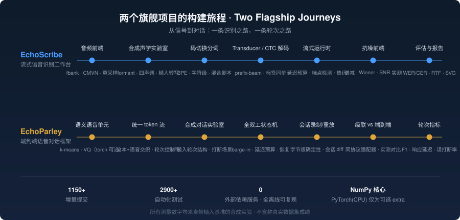

  

  
  
  
  

### 关于我

在**香港大学（The University of Hong Kong）**做语音方向的研究与工程，专注两条线：

- **语音识别（ASR）**——流式解码、transducer/CTC 的搜索数学、码切换（英中混合）评估、延迟预算下的分块调度
- **端到端语音对话（spoken dialogue）**——离散语音单元、文本+语音统一 token 流、全双工轮次机制（barge-in、打断恢复）、会话级确定性重放

我相信语音工具的**可复现性**应该像编译器一样严格：默认全离线、种子即结果、每个测量数字都能在一台笔记本上重跑出来。

### 旗舰项目

<table>
<tr>
<td width="50%" valign="top">
<h3><a href="https://github.com/mouse2p/echoscribe">🎙️ EchoScribe</a></h3>
<b>流式语音识别工作台</b>（Python · NumPy 核心 · torch CPU 可选）
<ul>
<li>RNN-T（transducer）与 CTC 解码：greedy、prefix-beam、标签同步分块解码，全部纯 NumPy 实现并带性质测试</li>
<li>合成声学实验室：formant 合成器 + 四声调合成语言 + 植入转写，train→decode→score 全管线离线可复现</li>
<li>码切换评估：WER（英）/ CER（中）/ 混合脚本评分规则，附对齐分解与 SVG 报告</li>
<li>流式运行时：延迟预算、端点检测、热词偏置、会话录制重放</li>
<li>600+ 增量提交 · 2400+ 测试 · CI 三版本矩阵</li>
</ul>
</td>
<td width="50%" valign="top">
<h3><a href="https://github.com/mouse2p/echoparley">💬 EchoParley</a></h3>
<b>端到端语音对话框架</b>（Python · NumPy 核心 · torch CPU 可选）
<ul>
<li>语义语音单元（确定性 k-means / 可选 VQ）与统一交织 token 流（含轮次控制符）</li>
<li>全双工轮次状态机：LISTEN → TAKE_FLOOR → SPEAK → YIELD → BARGE_IN → RECOVER，带延迟预算硬约束</li>
<li>两方对话模拟器 + 植入轮次结构的合成对话实验室，指标对基准真值可证</li>
<li>会话录制/重放字节级确定性；级联 vs 端到端同协议实测对比</li>
<li>540+ 增量提交 · 2400+ 测试 · CI 三版本矩阵</li>
</ul>
</td>
</tr>
</table>

### 方法与原则

- **离线优先**：默认测试与示例不需要网络、GPU、预训练权重或真实语音数据集
- **合成数据 + 植入真值**：所有报告数字来自带已知答案的合成实验，明确标注，绝不冒充真实基准成绩
- **每提交验证**：构建、测试、格式检查全绿才进历史；版本只走 patch 步进
- **确定性即契约**：同种子同输入 → 字节级一致输出，重放与直跑结果相同

### 构建旅程

### 贡献活动

<picture>
  <source media="(prefers-color-scheme: dark)" srcset="https://raw.githubusercontent.com/mouse2p/mouse2p/output/github-snake-dark.svg">
  
</picture>

  echo = 回声 · scribe = 书写者 · parley = 会谈 —— 让机器听清，也让机器懂得轮流说话。

